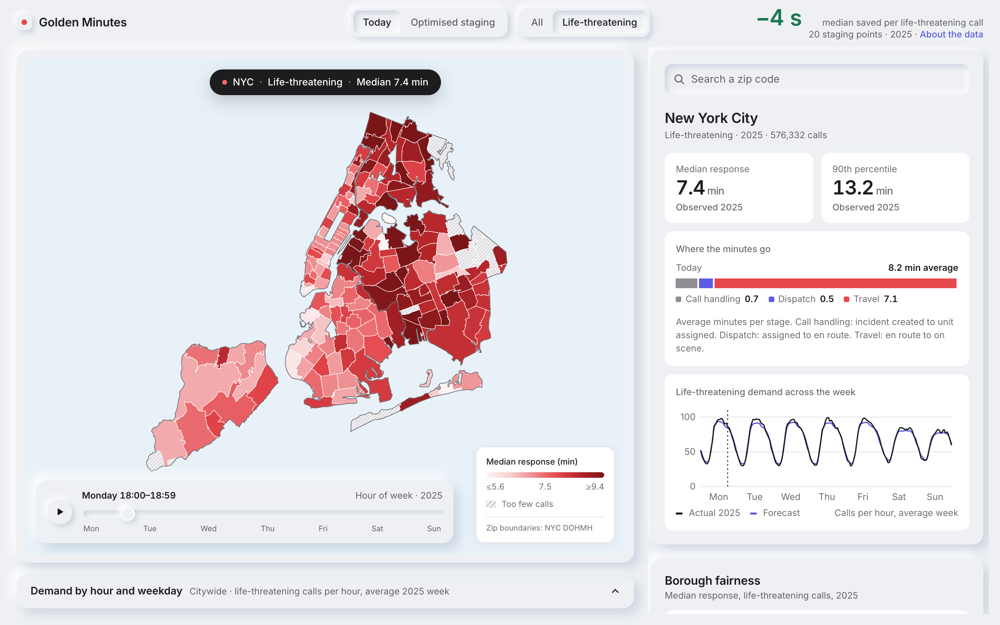
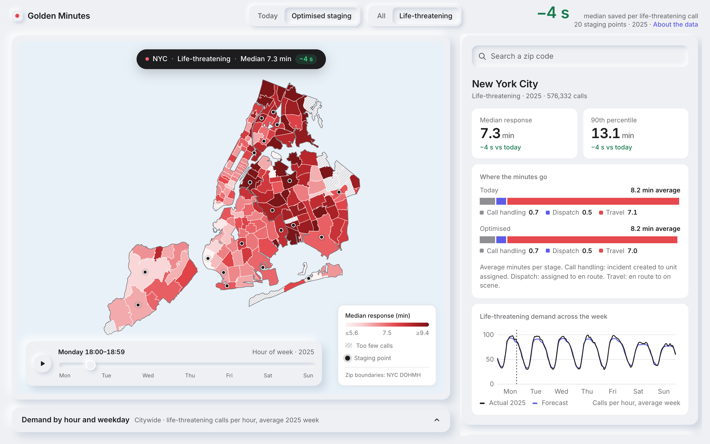
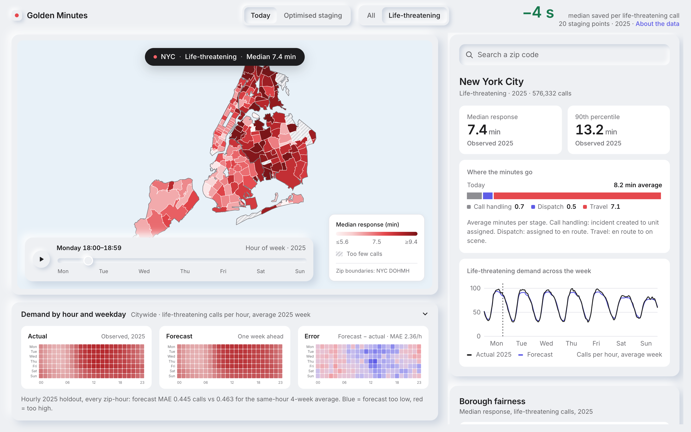

# Golden Minutes

Where and when New York City ambulance response times break down, how well life-threatening demand can be forecast by zip and hour, and how much staging idle ambulances could cut response times.



## Problem

For cardiac arrest, choking or a major stroke, minutes decide outcomes. FDNY EMS publishes every incident it dispatches. This project asks three questions of that data:

1. Which part of the response is slow, and where and when: call handling, dispatch or travel?
2. Can life-threatening demand be forecast by zip and hour well enough to plan around?
3. If idle ambulances were staged at demand-weighted points, how many minutes would life-threatening calls gain, and in which boroughs?

## Data

All data is real, public and used at full scale. Nothing is synthetic.

| Source | Use | Size |
|---|---|---|
| [EMS Incident Dispatch Data](https://data.cityofnewyork.us/d/76xm-jjuj) (FDNY, NYC Open Data) | Incidents created 2022-01-01 to 2025-12-31, pulled through the Socrata API month by month with paging | 6,444,090 rows (2022: 1,583,531; 2023: 1,617,839; 2024: 1,630,447; 2025: 1,612,273) |
| [MODZCTA](https://data.cityofnewyork.us/d/pri4-ifjk) (NYC DOHMH) | Zip polygons; maps incident zips to 177 areas | 178 polygons |
| [Facilities Database](https://data.cityofnewyork.us/d/ji82-xba5) (NYC Planning) | 34 FDNY EMS stations and 64 hospitals as known ambulance bases | 66 + 73 records |
| [Open-Meteo historical archive](https://open-meteo.com/en/docs/historical-weather-api) | Hourly Central Park weather for the forecast | 35,064 hours |

- Field definitions: `docs/data_dictionary.md`.
- Monthly row counts, each checked against the API's own count: `docs/ingest_row_counts.md`.

## Method

The pipeline lives in `src/`. Each step writes its outputs to `data/out/`, and the small result files are copied to `docs/results/`.

1. **Ingest** (`ingest.py`): downloads each month to Parquet and saves it only when the row count matches the API's `count(*)`. Re-runs skip months already cached.
2. **Clean** (`clean.py`, DuckDB): applies 19 rules, each a flag with its own count. Fourteen exclude a row from response-time analysis: standbys, transfers, no unit assigned, no unit en route, no unit on scene, impossible timestamp orders, any stage over 3 h, total over 3 h, zero travel, and the dataset's own invalid flag. Five only flag a row: held calls, reopened calls, special events, a computed response that disagrees with the published one, and a missing zip. Report: `docs/data_quality.md`. 6,007,941 rows (93.2%) are usable.
3. **Decompose** (`decompose.py`): splits response time using the dataset's own timestamps. Call handling runs from incident created to unit assigned, dispatch from assigned to en route, and travel from en route to on scene. Results are cut by year, borough, zip, hour of week, severity and held status (`docs/tables/`). Life-threatening means FDNY initial segments 1-3, the dispatcher's priority when the call came in; the mapping is in the data dictionary.
4. **Forecast** (`forecast.py`): hourly life-threatening calls for each of 177 zips, one week ahead. The baseline is the mean of the same hour over the previous 4 weeks. The model is gradient boosting (scikit-learn `HistGradientBoostingRegressor`, Poisson loss). Its inputs are zip, hour, weekday, month, NY holidays, hourly weather, demand 1-4 weeks earlier, and the mean of the week before last. Trained on 2022-2024 and tested on all of 2025.
5. **Travel model** (`travel.py`): weighted least squares on median travel time per zip × 4-hour block × year:
   `travel = a[block] + b[block] × distance to nearest EMS station or hospital + c × zip radius + borough + trend`.
   Trained on 2022-2024 and tested on 2025, with a leave-one-borough-out check.
6. **Simulate** (`simulate.py`): for each of the week's 42 four-hour blocks, picks K staging points among the zip centres. The choice minimises forecast demand × distance to the nearer of a known base and a staging point (a demand-weighted p-median, solved greedily and then improved by swaps). Each real 2025 life-threatening call then gets `b[block] × km closer` minutes taken off its observed travel. The sensitivity analysis varies how often the staged unit is free, the travel slope, the demand input, a single static plan, and the life-threatening definition.
7. **Export** (`export_web.py`): writes every number the app shows to `web/public/data/`.

## Findings

All figures are minutes. The response-time analysis uses rows that pass cleaning.

**1. Life-threatening response is getting slower, and travel is most of the rise.** Life-threatening median response rose from 6.8 min in 2022 to 7.4 in 2025, and the 90th percentile from 11.8 to 13.2. Of the +0.6 min rise in the median, travel accounts for +0.5. By stage, the median moved +0.1 for call handling, 0.0 for dispatch and +0.5 for travel. In 2025, average travel was 7.1 min of the 8.2 min average response, against 0.7 for call handling and 0.5 for dispatch (`docs/tables/breakdown_year.csv`).

**2. The system is running out of free units.** The share of life-threatening calls that were held, meaning no unit could be assigned at once, doubled from 2.5% in 2022 to 5.2% in 2025. For calls that are not life-threatening it rose from 9.8% to 29.0%, and their median response went from 9.0 to 12.4 min. Held life-threatening calls had a median of 9.5 min and a p90 of 19.6, against 7.3 and 12.9 for calls not held. Of the 3.7 min gap in mean response, 2.2 min (60%) is travel: the unit that finally frees up is often far away.

**3. Where and when.** In 2025 the Bronx was slowest (median 8.0, p90 14.0, 8.5% held), then Queens (7.7) and Manhattan (7.2, 7.3% held), with Staten Island at 7.1 and Brooklyn at 6.9. Among 173 zips with at least 200 life-threatening calls, the 10 slowest had a median of 9.4 min against 5.8 for the 10 fastest. The slowest were 10464 City Island (11.8), 10044 Roosevelt Island (10.6), 10307 Tottenville (10.1) and 11356 College Point (10.0): edge-of-network areas. The 15 slowest hours of the week all fall on weekdays between 15:00 and 19:00. The slowest was Friday 18:00 (median 8.6, p90 15.7) and the fastest Tuesday 00:00 (6.4).

**4. Demand is forecastable.** On the 2025 holdout, the model beat the 4-week baseline at every level. Zip-hour MAE was 0.445 against 0.463 calls (−3.8%), zip × 4-hour block 0.930 against 1.021 (−8.8%), and citywide hour 7.60 against 8.44 (−9.9%). RMSE and Poisson deviance agree; zip-hour deviance was 0.80 against 2.43.

**5. Staging alone buys seconds, not minutes.** At K = 20, life-threatening calls average 0.43 km closer to the nearest unit, and 24% of calls get faster. But the calibrated travel model turns that into a median saving of only 0.067 min (4 s), with the median moving from 7.37 to 7.30. At K = 10 the saving is 2 s and at K = 30 it is 5 s (p90 6 s). The gain is largest where bases are sparse: Staten Island (8 s at K = 20, 0.90 km closer) and Queens (8 s, 0.82 km). It is smallest in Manhattan (under 1 s, 0.10 km), where stations and hospitals are already close. A few zips far from any base gain much more: Rockaway 11694 and 11693 average 48 s and 47 s per call (about 5 km closer), and eastern Queens 11428 averages 42 s (`docs/tables/staging_saving_by_zip_k20.csv`). Full tables: `docs/simulation.md`.

**Sensitivity** (K = 20, median saved): 2 s if the staged unit is free only half the time, 3 s at three-quarters, and 8 s if distance matters twice as much as the model estimates. Using actual 2025 demand or 2022-2024 history instead of the forecast, or one plan for all hours, changes the result by under 1 s.

## Limitations

- **Aggregated locations.** Incidents are published only at zip level, so all distances run between zip interior points and base locations, not street addresses.
- **Unknown unit origin.** The data does not record where the responding ambulance came from, and FDNY units mostly wait at street-corner posts, not at stations. The travel model uses distance to the nearest EMS station or hospital as a stand-in. Geography explains little of the differences in travel time between zips: 2025 test MAE was 0.67 min against 0.71 for a model without geography, and R² was 0.01. The distance effect of 0.10-0.21 min per km is probably understated, so the staging savings are a conservative estimate. The station list from the Facilities Database is incomplete; it has one Staten Island site, for example.
- **Crew availability not modelled.** The simulation assumes a staged unit is free when a call arrives and that moving it slows no other call. Finding 2 suggests availability is the binding constraint, and staging cannot create free units.
- **Travel model approximations.** The model is linear, uses medians per cell, and has one speed effect per 4-hour block. 2025 travel ran 0.39 min above the 2022-2024 trend, which the model does not explain.
- **Reporting artefacts.** Timestamps are entered by crews and dispatchers. 4.9% of rows have no on-scene time, 1.1% show zero travel, and 0.35% have arrival before dispatch (see `docs/data_quality.md`). The dataset has no 911 answer time, so call handling starts when the incident is created in the EMS dispatch system.
- **Weather in the forecast is observed, not forecast**, which slightly flatters the model. Lagged demand carries most of its skill.
- **Fallbacks used** (details in `PROGRESS.md`): no NYC Open Data app token was available, so data was pulled without one. scikit-learn replaced LightGBM because LightGBM needs a system library. Hospitals were added to the station list because stations alone fit worse.

## The app

`web/` is a static Vite + React + TypeScript site with a MapLibre GL choropleth, D3 charts and Framer Motion.

- **Top bar:** toggles for Today / Optimised staging and All / Life-threatening, plus the headline saving.
- **Map:** median response for any hour of the week, with play/pause.
- **Island:** a floating summary that expands into a zip card.
- **Right panel:** response breakdown, demand line, borough fairness chart and staging scenarios.
- **Bottom drawer:** heatmaps of actual and forecast demand and the forecast error.

Every figure comes from `web/public/data/*.json`, which `src/export_web.py` generates. Design review passes and screenshots are in `docs/design_review.md` and `docs/screenshots/`.

| Selected zip | Optimised staging | Heatmap drawer |
|---|---|---|
|  |  |  |

## How to run

Requirements: Python 3.11+, Node 20+, and Google Chrome for the screenshots.

```bash
# Python pipeline (about 30-60 min the first time, mostly downloading; then minutes)
python3 -m venv .venv && .venv/bin/pip install -r requirements.txt
echo "NYC_APP_TOKEN=<your NYC Open Data app token>" > .env   # optional, speeds up the download
./run_pipeline.sh

# tests and lint
.venv/bin/pytest
.venv/bin/ruff check src tests

# web app
cd web
npm install
npm run dev            # http://localhost:5173
npm run build          # type-check, lint-free production build in web/dist
npx vite preview --port 4173 &
node scripts/screens.mjs http://localhost:4173/ ../docs/screenshots/final 11207
```

`data/` (raw downloads, cleaned Parquet and intermediate outputs) and `.env` are not committed.

## Repository map

| Path | Contents |
|---|---|
| `src/` | Pipeline: ingest, dictionary, clean, decompose, forecast, travel, simulate, export_web, plus geo and config |
| `tests/` | pytest suite for the cleaning rules and metrics (26 tests) |
| `docs/` | Data dictionary, data quality report, findings, simulation tables, results JSON, design review and screenshots |
| `web/` | The app |
| `MEMO.md` | One-page memo |
| `PLAN.md`, `PROGRESS.md` | Milestones, progress and blockers |
