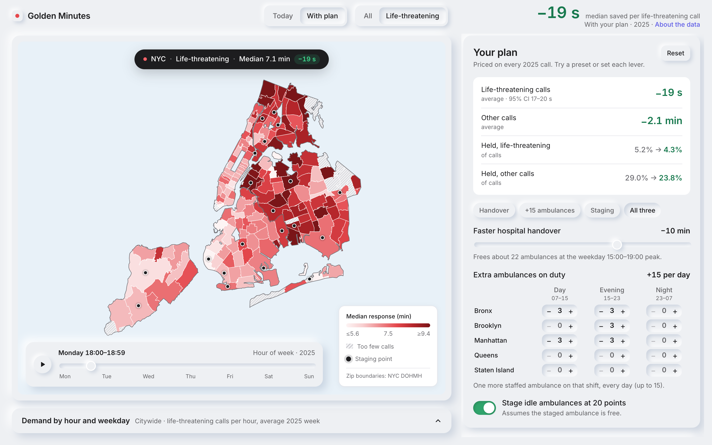
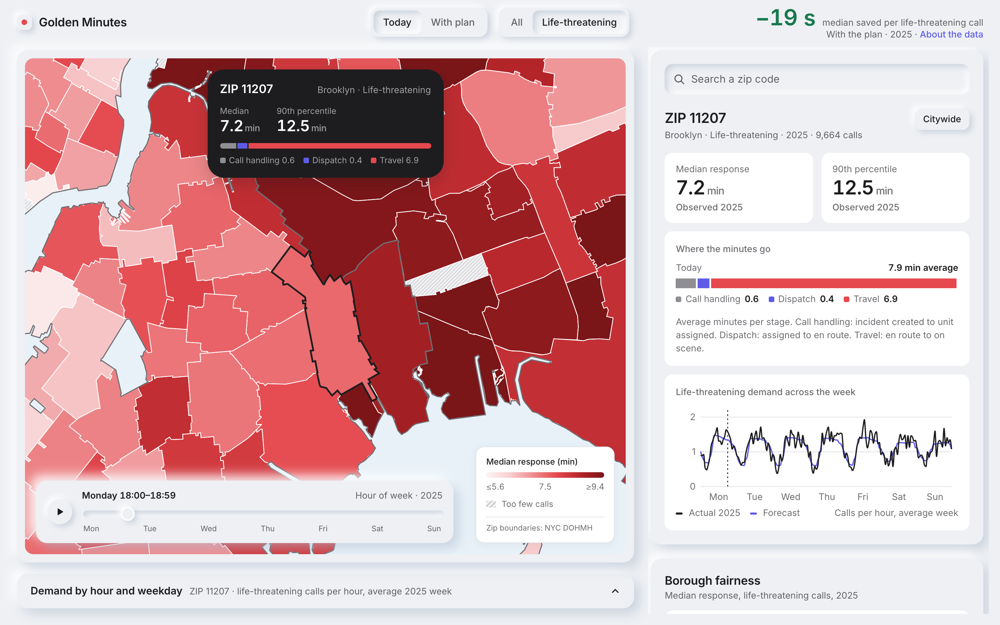

# Golden Minutes

Why New York City ambulances are getting slower, what one more free ambulance is worth, and which levers buy back the most seconds for life-threatening calls. Built on 6.4 million real FDNY incidents, with an interactive planner that prices any mix of extra ambulances, faster hospital handover and staging.



## Problem

For cardiac arrest, choking or a major stroke, minutes decide outcomes. FDNY EMS publishes every incident it dispatches. This project asks three questions of that data:

1. Which part of the response is slow, and where and when: call handling, dispatch or travel?
2. Why is it getting slower, and how much does one more free ambulance change a response?
3. Which levers buy back the most time: more ambulances, faster hospital handover, or staging idle ambulances closer to demand?
4. Can life-threatening demand be forecast by zip and hour well enough to plan around?

## Data

All data is real, public and used at full scale. Nothing is synthetic.

| Source | Use | Size |
|---|---|---|
| [EMS Incident Dispatch Data](https://data.cityofnewyork.us/d/76xm-jjuj) (FDNY, NYC Open Data) | Incidents created 2022-01-01 to 2025-12-31, pulled through the Socrata API month by month with paging | 6,444,090 rows (2022: 1,583,531; 2023: 1,617,839; 2024: 1,630,447; 2025: 1,612,273) |
| [MODZCTA](https://data.cityofnewyork.us/d/pri4-ifjk) (NYC DOHMH) | Zip polygons; maps incident zips to 177 areas | 178 polygons |
| [Facilities Database](https://data.cityofnewyork.us/d/ji82-xba5) (NYC Planning) | 34 FDNY EMS stations and 64 hospitals as known ambulance bases | 66 + 73 records |
| [Open-Meteo historical archive](https://open-meteo.com/en/docs/historical-weather-api) | Hourly Central Park weather for the forecast | 35,064 hours |

- Field definitions: `docs/data_dictionary.md`.
- Monthly row counts, each checked against the API's own count: `docs/ingest_row_counts.md`.

## Method

The pipeline lives in `src/`. Each step writes its outputs to `data/out/`, and the small result files are copied to `docs/results/`.

1. **Ingest** (`ingest.py`): downloads each month to Parquet and saves it only when the row count matches the API's `count(*)`. Re-runs skip months already cached.
2. **Clean** (`clean.py`, DuckDB): applies 19 rules, each a flag with its own count. Fourteen exclude a row from response-time analysis: standbys, transfers, no unit assigned, no unit en route, no unit on scene, impossible timestamp orders, any stage over 3 h, total over 3 h, zero travel, and the dataset's own invalid flag. Five only flag a row: held calls, reopened calls, special events, a computed response that disagrees with the published one, and a missing zip. Report: `docs/data_quality.md`. 6,007,941 rows (93.2%) are usable.
3. **Decompose** (`decompose.py`): splits response time using the dataset's own timestamps. Call handling runs from incident created to unit assigned, dispatch from assigned to en route, and travel from en route to on scene. Results are cut by year, borough, zip, hour of week, severity and held status (`docs/tables/`). Life-threatening means FDNY initial segments 1-3, the dispatcher's priority when the call came in; the mapping is in the data dictionary.
4. **Forecast** (`forecast.py`): hourly life-threatening calls for each of 177 zips, one week ahead. The baseline is the mean of the same hour over the previous 4 weeks. The model is gradient boosting (scikit-learn `HistGradientBoostingRegressor`, Poisson loss). Its inputs are zip, hour, weekday, month, NY holidays, hourly weather, demand 1-4 weeks earlier, and the mean of the week before last. Trained on 2022-2024 and tested on all of 2025.
5. **Travel model** (`travel.py`): weighted least squares on median travel time per zip × 4-hour block × year:
   `travel = a[block] + b[block] × distance to nearest EMS station or hospital + c × zip radius + borough + trend`.
   Trained on 2022-2024 and tested on 2025, with a leave-one-borough-out check.
6. **Simulate** (`simulate.py`): for each of the week's 42 four-hour blocks, picks K staging points among the zip centres. The choice minimises forecast demand × distance to the nearer of a known base and a staging point (a demand-weighted p-median, solved greedily and then improved by swaps). Each real 2025 life-threatening call then gets `b[block] × km closer` minutes taken off its observed travel. The sensitivity analysis varies how often the staged unit is free, the travel slope, the demand input, a single static plan, and the life-threatening definition.
7. **Capacity** (`capacity.py`): a job runs from first unit assigned to incident closed; jobs open at the same minute give the number of busy ambulances in each borough. For every call, the busy count in its borough at the minute it was created is compared only with calls in the same borough, year and hour of week, and on the same borough-day (two-way fixed effects; standard errors clustered by borough-day). The slope is the minutes added by one more busy ambulance. Checks: busy ambulances in a different borough as a placebo, the slope by year and borough, and a holdout (fit 2022-2024, test 2025). Report: `docs/capacity.md`.
8. **Plan** (`web/src/lib/plan.ts`, priced in the browser): one more ambulance on duty is taken as one fewer busy ambulance. A shorter hospital handover frees transports per hour × minutes saved / 60 ambulances (Little's law). Staging uses step 6. Effects add up. `web/scripts/plan-presets.ts` runs the same engine on the preset plans and writes `docs/results/plan_presets.json`.
9. **Export** (`export_web.py`): writes every number the app shows to `web/public/data/`.

## Findings

All figures are minutes unless stated. The response-time analysis uses rows that pass cleaning.

**1. Life-threatening response is getting slower, and travel is most of the rise.** Life-threatening median response rose from 6.8 min in 2022 to 7.4 in 2025, and the 90th percentile from 11.8 to 13.2. Of the +0.6 min rise in the median, travel accounts for +0.5 (call handling +0.1, dispatch 0.0). In 2025, average travel was 7.1 min of the 8.2 min average response (`docs/tables/breakdown_year.csv`).

**2. The number of jobs is flat, but each job ties up an ambulance longer.** Assigned jobs were 1,573,224 in 2022 and 1,573,538 in 2025, yet the average job (assignment to close) grew from 65.2 to 71.4 min. On average 195 ambulances were busy at any moment in 2022 and 214 in 2025: about 19 more, with the same number of jobs. By stage, getting to the scene grew most (+2.5 min per job), then on scene (+1.9), time at hospital (+1.1) and transport (+0.7). Time at hospital is the largest single stage of a transport, a median of 41 min in 2025 against 38 in 2022 (`docs/capacity.md`).

**3. Every busy ambulance costs the next life-threatening call 2.4 seconds.** Comparing calls in the same borough, hour of week and day, each extra busy ambulance in the borough when a call comes in adds 0.039 min (2.4 s; 95% CI 2.2-2.5 s) to life-threatening response, over 2.3 million calls. Travel accounts for 92% of it: the nearest free ambulance is further away. Other calls lose 0.34 min (20 s) per busy ambulance, about half of it waiting to be assigned. The effect holds every year (1.9-2.7 s) and in every borough. It is largest on Staten Island (9.7 s), which has the fewest ambulances. Busy ambulances in a different borough have no effect (−0.2 s), so citywide weather or traffic does not explain it. Fitted on 2022-2024, the slopes predict the 2025 pattern with an error of 0.04 min, against 0.23 min assuming no effect. The extra busy ambulances since 2022 account for about a quarter of the rise in mean life-threatening response (+0.19 of +0.75 min). The rest is consistent with fewer staffed ambulances, slower traffic, or both, which the data cannot separate.

**4. Freeing ambulances beats moving them.** Priced with that estimate on every 2025 call (`docs/results/plan_presets.json`, average saving per life-threatening call):

| Lever | Life-threatening | Other calls | Held life-threatening | Held other |
|---|---|---|---|---|
| Stage idle ambulances at 20 points (assumed free) | 4 s | 4 s | 5.2% (no change) | 29.0% (no change) |
| +1 ambulance on every shift in every borough (15 a day) | 3 s | 22 s | 5.1% | 28.1% |
| +15 ambulance-shifts placed where they save most | 4 s | 31 s | 5.0% | 27.8% |
| Hospital handover 5 min faster | 6 s | 47 s | 4.9% | 27.0% |
| Hospital handover 10 min faster | 11 s (95% CI 10-12) | 93 s | 4.5% | 25.0% |
| Hospital handover 15 min faster | 17 s | 140 s | 4.2% | 23.0% |
| Handover −10 min, +15 ambulance-shifts and staging | 19 s (median 7.37 → 7.06 min) | 129 s | 4.3% | 23.8% |

A 10-minute faster handover frees about 22 ambulances at the weekday 15:00-19:00 peak, more than adding an ambulance to every shift in every borough. Bringing the average job back to its 2022 length would free about 18 ambulances and save about 11 s per life-threatening call. For a single extra ambulance-shift, the best places by life-threatening minutes saved per week are Manhattan evening and day shifts (55 and 53 min), then Brooklyn evenings and Bronx evenings and days (38-39 min) (`docs/results/one_ambulance_per_shift.csv`).

**5. Where and when.** In 2025 the Bronx was slowest (median 8.0, p90 14.0, 8.5% held), then Queens (7.7) and Manhattan (7.2, 7.3% held), with Staten Island at 7.1 and Brooklyn at 6.9. Among 173 zips with at least 200 life-threatening calls, the 10 slowest had a median of 9.4 min against 5.8 for the 10 fastest. The slowest were 10464 City Island (11.8), 10044 Roosevelt Island (10.6), 10307 Tottenville (10.1) and 11356 College Point (10.0): edge-of-network areas. The 15 slowest hours of the week all fall on weekdays between 15:00 and 19:00. The slowest was Friday 18:00 (median 8.6, p90 15.7) and the fastest Tuesday 00:00 (6.4).

**6. The system is short of free units.** The share of life-threatening calls that were held, meaning no unit could be assigned at once, doubled from 2.5% in 2022 to 5.2% in 2025. For calls that are not life-threatening it rose from 9.8% to 29.0%, and their median response went from 9.0 to 12.4 min. Held life-threatening calls had a median of 9.5 min and a p90 of 19.6, against 7.3 and 12.9 for calls not held.

**7. Demand is forecastable.** On the 2025 holdout, the model beat the 4-week baseline at every level. Zip-hour MAE was 0.445 against 0.463 calls (−3.8%), zip × 4-hour block 0.930 against 1.021 (−8.8%), and citywide hour 7.60 against 8.44 (−9.9%). RMSE and Poisson deviance agree; zip-hour deviance was 0.80 against 2.43.

**8. Staging alone buys seconds, and only where bases are far.** At K = 20, life-threatening calls average 0.43 km closer to the nearest unit, and 24% of calls get faster, but the median saving is 0.067 min (4 s). At K = 10 it is 2 s and at K = 30 5 s. It is largest where bases are sparse: Staten Island and Queens (8 s each) and a few far-flung zips, such as Rockaway 11694 and 11693 (48 s and 47 s per call) and eastern Queens 11428 (42 s) (`docs/tables/staging_saving_by_zip_k20.csv`). Manhattan gains under 1 s. Sensitivity (K = 20, median saved): 2 s if the staged unit is free only half the time, 8 s if distance matters twice as much as the travel model estimates (`docs/simulation.md`).

## Limitations

- **Aggregated locations.** Incidents are published only at zip level, so all distances run between zip interior points and base locations, not street addresses.
- **Unknown unit origin.** The data does not record where the responding ambulance came from, and FDNY units mostly wait at street-corner posts, not at stations. The travel model uses distance to the nearest EMS station or hospital as a stand-in. Geography explains little of the differences in travel time between zips: 2025 test MAE was 0.67 min against 0.71 for a model without geography, and R² was 0.01. The distance effect of 0.10-0.21 min per km is probably understated, so the staging savings are a conservative estimate. The station list from the Facilities Database is incomplete; it has one Staten Island site, for example.
- **Crew availability.** Staging assumes a staged unit is free when a call arrives and that moving it slows no other call. The capacity model does price availability, but only for the first unit on each incident: the data does not record every vehicle sent, so busy counts are first-unit jobs, and the incident close time stands in for the unit becoming free.
- **Short-run evidence for a long-run plan.** The 2.4 s estimate comes from hour-to-hour swings in workload. A permanent change in staffing or handover times could shift how dispatchers hold calls or where crews wait. The plan is capped at 15 extra ambulances per borough-shift and 15 minutes of handover, inside the range the holdout covers; beyond about 20 more or fewer busy ambulances than usual (under 0.2% of calls) the effect flattens. Savings are the expected direction and size, not a guarantee.
- **Hospital handover is measured, not attributed.** Time at hospital runs from hospital arrival to incident close, which includes the crew cleaning and restocking. The data does not name the hospital, so the handover lever cannot be targeted hospital by hospital.
- **Travel model approximations.** The model is linear, uses medians per cell, and has one speed effect per 4-hour block. 2025 travel ran 0.39 min above the 2022-2024 trend, which the model does not explain.
- **Reporting artefacts.** Timestamps are entered by crews and dispatchers. 4.9% of rows have no on-scene time, 1.1% show zero travel, and 0.35% have arrival before dispatch (see `docs/data_quality.md`). The dataset has no 911 answer time, so call handling starts when the incident is created in the EMS dispatch system.
- **Weather in the forecast is observed, not forecast**, which slightly flatters the model. Lagged demand carries most of its skill.
- **The app's map** under a plan shifts each zip-hour median by the capacity saving for its borough and hour; the panel figures use full response distributions per zip, shift and call type.
- **Fallbacks used** (details in `PROGRESS.md`): no NYC Open Data app token was available, so data was pulled without one. scikit-learn replaced LightGBM because LightGBM needs a system library. Hospitals were added to the station list because stations alone fit worse.

## The app

`web/` is a static Vite + React + TypeScript site with a MapLibre GL choropleth, D3 charts and Framer Motion.

- **Top bar:** Today / With plan, All / Life-threatening, and the median seconds the plan saves.
- **Your plan:** presets (faster handover, +15 ambulances, staging, all three) or set each lever: a handover slider, a borough × shift grid of extra ambulances, and a staging switch. Every number on the page, from the map to the Island and the borough chart, re-prices instantly, with a 95% interval and the effect on held calls. Plans are kept in the URL, so a plan can be shared as a link.
- **Map:** median response for any hour of the week under today or the plan, with play/pause.
- **Island:** a floating summary that expands into a zip card.
- **Right panel:** response breakdown, demand line, borough fairness, what each lever buys, why responses slowed, and the evidence chart behind the 2.4 s estimate.
- **Bottom drawer:** heatmaps of actual and forecast demand and the forecast error.

Every figure comes from `web/public/data/*.json`, which `src/export_web.py` generates. Design review passes and screenshots are in `docs/design_review.md` and `docs/screenshots/`.

| Plan view | Selected zip | Heatmap drawer |
|---|---|---|
|  |  |  |

## How to run

Requirements: Python 3.11+, Node 20+, and Google Chrome for the screenshots.

```bash
# Python pipeline (about 30-60 min the first time, mostly downloading; then minutes)
python3 -m venv .venv && .venv/bin/pip install -r requirements.txt
echo "NYC_APP_TOKEN=<your NYC Open Data app token>" > .env   # optional, speeds up the download
./run_pipeline.sh

# tests and lint
.venv/bin/pytest
.venv/bin/ruff check src tests

# web app
cd web
npm install
npm run dev            # http://localhost:5173
npm run build          # type-check, lint-free production build in web/dist
npx vite preview --port 4173 &
node scripts/screens.mjs http://localhost:4173/ ../docs/screenshots/final 11207
node --experimental-strip-types scripts/plan-presets.ts   # prices the preset plans
```

`data/` (raw downloads, cleaned Parquet and intermediate outputs) and `.env` are not committed.

## Repository map

| Path | Contents |
|---|---|
| `src/` | Pipeline: ingest, dictionary, clean, decompose, forecast, travel, simulate, capacity, export_web, plus geo and config |
| `tests/` | pytest suite for the cleaning rules, metrics and capacity methods (31 tests) |
| `docs/` | Data dictionary, data quality report, findings, capacity and simulation reports, results JSON, design review and screenshots |
| `web/` | The app |
| `MEMO.md` | One-page memo |
| `PLAN.md`, `PROGRESS.md` | Milestones, progress and blockers |
